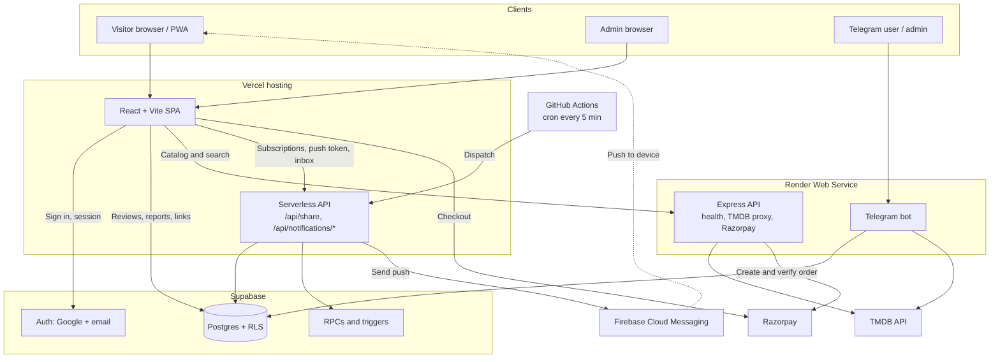
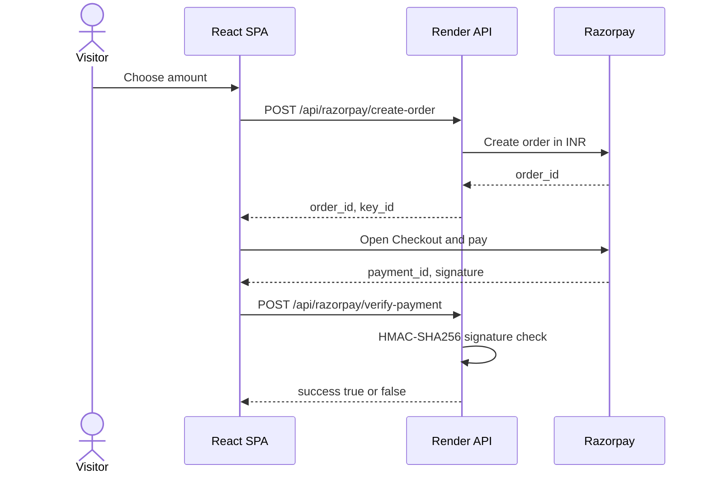
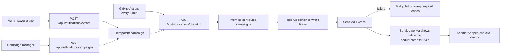

<div align="center">

# 🎬 MovieVerify

**A Netflix-inspired movie & TV discovery platform with user accounts, push notifications, a secure admin console, Telegram bot control and PWA support.**

[](https://movieverify.vercel.app)


</div>

---

## Table of Contents

- [About](#about)
- [Features](#features)
- [Tech Stack](#tech-stack)
- [Architecture](#architecture)
- [Screenshots](#screenshots)
- [Getting Started](#getting-started)
- [Environment Variables](#environment-variables)
- [Database](#database)
- [API Reference](#api-reference)
- [Telegram Bot](#telegram-bot)
- [Notification System](#notification-system)
- [Project Structure](#project-structure)
- [Deployment](#deployment)
- [Security Notes](#security-notes)
- [Roadmap](#roadmap)
- [Disclaimer](#disclaimer)
- [Acknowledgements](#acknowledgements)
- [Author](#author)

---

## About

MovieVerify is a full-stack movie and TV discovery platform. Metadata (posters, ratings, cast, trailers) comes from **TMDB**. **Supabase** provides authentication, the Postgres database and row-level security. **Vercel serverless functions** power the notification pipeline and shareable link previews, while a **Node.js service on Render** runs the Telegram bot, the payment API and a TMDB proxy.

What began as a UI exercise has grown into a complete product: Google sign-in, per-user subscriptions, scheduled push campaigns, an admin console, bot-based administration and an installable PWA.

---

## Features

### For visitors

- **Netflix-style interface**: rotating hero carousel, auto-scrolling content rows (with touch and drag scrolling on mobile), category tabs for Home, TV Shows, Movies and New & Popular
- **Smart search**: live typeahead suggestions plus filters for genre, language, minimum rating and sort order
- **Genre pages** with "Load more" pagination
- **Actor and actress directories**: TMDB person lookup with a full filmography per person
- **Title details modal**: cast, runtime, trailer, links per quality, TV seasons and episodes
- **Latest releases row**: recent Indian-language releases surfaced on the home feed
- **Personalisation**: *My List*, *Continue Browsing* and download history, stored locally in the browser
- **Accounts**: Google OAuth sign-in
- **Subscriptions ("Notify me")**: follow movies, TV series, individual seasons, actors and genres
- **Notification centre**: in-app inbox with unread badge, mark-as-read, deep-links and a welcome message for new users
- **Browser push (FCM)**: per-category toggles, timezone-aware quiet hours and a daily push cap
- **Reviews and ratings** (1–5 stars) with basic content moderation
- **Report a problem** on any title
- **Sharing**: WhatsApp, copy link and native share, with dynamic Open Graph previews for movies and TV shows
- **Deep links**: `/?type=movie&id=…` opens a title directly
- **Support section**: ₹5 / ₹10 / ₹50 / custom donations through Razorpay (test mode)
- **Site lock gate** and a cinematic first-visit intro animation
- **Installable PWA** with an in-app install button

### For the admin

- **Secure admin console**: Supabase Auth plus an `admin_users` allow-list check, available at `/admin` or through the sign-in modal
- **Catalog manager**: TMDB lookup, per-quality links, custom descriptions, and season/episode editing for TV, with filters for missing 720p, missing 1080p and complete entries
- **Automatic release alerts**: saving a new title, season or update posts an event that becomes a notification campaign
- **Campaign manager**: create immediate or scheduled broadcast or targeted campaigns, preview the push, and track sent, success, failed, open and click counts
- **Reports inbox**: resolve or delete user reports
- **Analytics dashboard**: catalog completeness, pending reports, average rating, most reviewed titles and recent reviews
- **Site lock control**: toggle the gate and set the key without redeploying
- **Telegram bot** administration (see [Telegram Bot](#telegram-bot))

### Engineering highlights

- **Row Level Security** on the notification schema with `FORCE ROW LEVEL SECURITY`, column-scoped grants, `security_invoker` views and an append-only audit log
- **Idempotent campaign ingestion** and a **lease-based delivery worker** with retries, quiet-hour handling and daily caps
- **Delivery telemetry**: received, displayed, opened, clicked and dismissed events
- **Server-verified payments**: HMAC-SHA256 signature check, with the secret kept server-side
- **Service worker**: network-first caching for same-origin GETs only, push de-duplication in IndexedDB (24 h) and open-redirect-safe notification clicks
- **TMDB proxy** on the backend to avoid exposing tokens and to work on networks that block TMDB directly
- **Resilient data layer**: batched TMDB lookups, session and in-memory caching, and defensive handling of missing genres, ratings and images
- **Image pipeline**: concurrency-limited loader with a poster → backdrop → placeholder fallback chain
- **Open Graph prewarming** so WhatsApp link previews render with artwork

---

## Tech Stack

| Layer | Technology |
| --- | --- |
| Frontend | React 19, Vite 8, React Router 7 |
| Styling and motion | Tailwind CSS 3, Framer Motion, Lucide icons |
| Data and auth | Supabase (PostgreSQL, Auth, RLS), TMDB API |
| Notifications | Firebase Cloud Messaging (FCM v1), Web Push, service worker |
| Serverless API | Vercel Functions (Node.js) |
| Backend service | Node.js, Express, `node-telegram-bot-api`, Razorpay SDK |
| Scheduling | GitHub Actions (cron) |
| Hosting | Vercel (frontend and serverless), Render (backend service) |
| Tooling | oxlint, PostCSS, Autoprefixer |

---

## Architecture

### System Architecture



### Payment Flow



---

## Screenshots

> Add your screenshots to `docs/screenshots/` and update the paths below.

| Home | Title Details |
| --- | --- |
|  |  |

| Notifications | Admin Console |
| --- | --- |
|  |  |

---

## Getting Started

### Prerequisites

- Node.js 20+
- A [TMDB](https://www.themoviedb.org/settings/api) account (v4 read access token)
- A [Supabase](https://supabase.com) project (Google provider enabled for sign-in)
- A [Firebase](https://firebase.google.com) project with Cloud Messaging (only for push notifications)

### Installation

```bash
# 1. Clone
git clone https://github.com/akramiyi/movieverify.git
cd movieverify

# 2. Install dependencies
npm install

# 3. Configure environment
cp .env.example .env     # then fill in the values (see below)

# 4. Start the dev server
npm run dev
```

### Scripts

| Command | Description |
| --- | --- |
| `npm run dev` | Start the Vite dev server |
| `npm run build` | Production build |
| `npm run preview` | Preview the production build |
| `npm run lint` | Run oxlint |

### Backend service (optional)

The Telegram bot, payment API and TMDB proxy live in `telegram-bot/`:

```bash
cd telegram-bot
npm install
node index.js
```

> Run **only one** instance of the bot at a time, otherwise Telegram returns `409 Conflict`.

---

## Environment Variables

> Never commit `.env` files. Anything prefixed with `VITE_` is bundled into the browser, so never put secrets there.

### Frontend (`.env`)

| Variable | Description |
| --- | --- |
| `VITE_SUPABASE_URL` | Supabase project URL |
| `VITE_SUPABASE_ANON_KEY` | Supabase anon (public) key |
| `VITE_TMDB_TOKEN` | TMDB v4 read access token (used by a few direct calls) |
| `VITE_API_URL` | Base URL of the Render backend service |
| `VITE_FIREBASE_API_KEY`, `VITE_FIREBASE_AUTH_DOMAIN`, `VITE_FIREBASE_PROJECT_ID`, `VITE_FIREBASE_STORAGE_BUCKET`, `VITE_FIREBASE_MESSAGING_SENDER_ID`, `VITE_FIREBASE_APP_ID`, `VITE_FIREBASE_MEASUREMENT_ID` | Firebase web app config |
| `VITE_FIREBASE_VAPID_KEY` | Web Push certificate key for FCM |

### Vercel serverless functions (`api/`)

| Variable | Description |
| --- | --- |
| `SUPABASE_URL` | Supabase project URL |
| `SUPABASE_SERVICE_ROLE_KEY` | Service role key (**server only**) |
| `SUPABASE_ANON_KEY` | Anon key used to validate user JWTs |
| `INTERNAL_WORKER_SECRET` / `CRON_SECRET` | Shared secret for the dispatch endpoint |
| `NOTIFICATION_DISPATCH_ENABLED` | Kill switch, must be `true` to send |
| `CAMPAIGN_API_SECRET` | Machine-to-machine secret for campaign and event ingestion |
| `FIREBASE_SERVICE_ACCOUNT` *or* `FIREBASE_PROJECT_ID`, `FIREBASE_CLIENT_EMAIL`, `FIREBASE_PRIVATE_KEY` | Firebase Admin credentials for FCM v1 |
| `TMDB_READ_TOKEN` | TMDB token used by the share-preview endpoint |

### Render backend (`telegram-bot/`)

| Variable | Description |
| --- | --- |
| `TELEGRAM_BOT_TOKEN` | Bot token from BotFather |
| `TELEGRAM_ADMIN_IDS` | Comma-separated Telegram user IDs allowed to administer |
| `SUPABASE_URL` | Supabase project URL |
| `SUPABASE_SERVICE_ROLE_KEY` | Service role key (**server only**) |
| `TMDB_TOKEN` | TMDB read access token |
| `RAZORPAY_KEY_ID` | Razorpay key ID (test or live) |
| `RAZORPAY_KEY_SECRET` | Razorpay secret (**server only**) |
| `FRONTEND_URL` | Allowed CORS origin, e.g. `https://movieverify.vercel.app` |
| `PORT` | Provided by the host (defaults to `3000`) |

### GitHub Actions

| Name | Type | Description |
| --- | --- | --- |
| `PRODUCTION_NOTIFICATION_DISPATCH_ENABLED` | Repository variable | Enables the 5-minute production dispatcher |
| `CRON_SECRET` | Repository secret | Authenticates the dispatch call |

---

## Database

### Application tables

| Table | Purpose |
| --- | --- |
| `download_links` | Admin-managed entries: per-quality URLs and TV `seasons` as JSONB |
| `movie_reviews` | User reviews and ratings |
| `movie_reports` | "Report a problem" submissions |
| `site_settings` | Single-row site lock configuration |
| `admin_users` | Allow-list of admin user IDs |

> These five tables are created manually in the Supabase SQL editor. Tables created that way also need explicit grants, otherwise requests fail with `403`:
>
> ```sql
> GRANT SELECT, INSERT ON movie_reviews TO anon, authenticated;
> GRANT DELETE ON movie_reviews TO authenticated;
> ```

### Notification schema (`supabase/migrations/`)

| Group | Tables |
| --- | --- |
| Devices and preferences | `notification_endpoints`, `user_notification_preferences`, `notification_opt_outs` |
| Subscriptions | `notification_subscriptions`, `movie_notify_requests`, `actor_notify_requests`, `genre_notify_requests` |
| Campaigns and delivery | `notification_campaigns`, `notification_queue`, `notification_deliveries` |
| Inbox and analytics | `user_notifications`, `notification_telemetry`, `user_welcome_dispatches` |
| Compliance | `notification_audit_log` (append-only) |

All notification tables have RLS **enabled and forced**. Anonymous access is revoked, authenticated users are limited to their own rows, and campaign, queue and audit data is admin- or service-role-only. Dispatch, scheduling, welcome and telemetry logic runs through `SECURITY DEFINER` RPCs that only the service role may execute.

Run the migrations in order with the Supabase CLI:

```bash
supabase db push
```

---

## API Reference

### Vercel serverless (`/api`)

| Endpoint | Auth | Purpose |
| --- | --- | --- |
| `GET /api/share` | None | Open Graph / Twitter Card HTML for shared titles, then redirects to the app |
| `GET, POST /api/notifications/preferences` | User JWT | Read and update notification preferences |
| `POST /api/notifications/register` | User JWT | Register or refresh an FCM token |
| `POST, DELETE /api/notifications/revoke` | User JWT | Revoke a device token |
| `GET, POST, DELETE /api/notifications/subscriptions` | User JWT | Manage release subscriptions |
| `GET, PATCH /api/notifications/user` | User JWT | Fetch inbox and mark as read |
| `POST /api/notifications/welcome` | User JWT | Issue the first-login welcome notification |
| `POST /api/notifications/telemetry` | User JWT | Record delivery engagement events |
| `POST, DELETE /api/notifications/campaigns` | Admin JWT or M2M secret | Create or cancel campaigns |
| `POST /api/notifications/events` | Admin JWT or M2M secret | Turn release events into campaigns |
| `POST /api/notifications/dispatch` | Worker secret + kill switch | Promote scheduled campaigns and send due deliveries |

### Render backend

| Endpoint | Purpose |
| --- | --- |
| `GET /health` | Health check, returns `{ "status": "ok" }` |
| `GET /api/tmdb/*` | TMDB proxy |
| `POST /api/razorpay/create-order` | Create a Razorpay order (amount in INR) |
| `POST /api/razorpay/verify-payment` | Verify the payment signature server-side |

---

## Telegram Bot

| Command | Access | Description |
| --- | --- | --- |
| `/start`, `/help` | Everyone | Welcome message and usage guide |
| `/search <query>` | Everyone | Search TMDB and get quality buttons or season/episode keyboards for titles that have links |
| `/admin` | Admin | Open the admin menu |
| `/stats` | Admin | Totals for movies, TV and each quality |
| `/list` | Admin | Paginated list of configured titles |
| `/searchadmin <query>` | Admin | Search TMDB, then add, update or delete links through a guided 480p → 720p → 1080p flow |

Admin access is enforced by checking the sender's numeric Telegram ID against `TELEGRAM_ADMIN_IDS`.

---

## Notification System



Quiet hours, per-category opt-outs and daily caps are enforced before a push is leased. An in-app inbox copy is always kept, even when push is suppressed.

---

## Project Structure

```
movieverify/
├── api/                      # Vercel serverless functions
│   ├── share.js              # Open Graph share pages
│   ├── notifications/        # campaigns, events, dispatch, register, ...
│   └── _lib/                 # Supabase server client, FCM worker, services
├── public/                   # manifest.json, sw.js, og-fallback.jpg
├── src/
│   ├── components/           # UI, admin panel, notification center, ...
│   ├── hooks/                # useTMDB, useSubscriptions, usePushNotifications, ...
│   ├── pages/                # Genre and actor listing pages
│   ├── services/             # Firebase client
│   ├── utils/                # Image manager, moderation, notification helpers
│   ├── data/                 # Supabase client, static data
│   ├── App.jsx
│   └── main.jsx
├── telegram-bot/             # Express API, Telegram bot, Razorpay, TMDB proxy
│   ├── handlers/             # userHandlers.js, adminHandlers.js
│   └── index.js
├── supabase/migrations/      # Notification schema, RLS, RPCs, triggers
├── tests/db/                 # Database fixtures and preflight scripts
├── .github/workflows/        # Dispatch cron, Supabase keep-alive
└── vercel.json               # Rewrites for share links and SPA fallback
```

### Routes

| Route | Description |
| --- | --- |
| `/` | Home feed, search, support section, modals |
| `/genre/:genreSlug` | Genre listing with load-more |
| `/actors`, `/actresses` | Full actor and actress directories |
| `/admin` | Admin console |
| `/share/:type/:id` | Rewritten server-side to `/api/share` |

---

## Deployment

| Part | Platform | Notes |
| --- | --- | --- |
| Frontend and `/api` | **Vercel** | Set all `VITE_*` and server variables, then redeploy (`VITE_*` values are inlined at build time) |
| Backend service | **Render** (Web Service) | Root directory `telegram-bot`, build `npm install`, start `node index.js`, health check `/health` |
| Scheduling | **GitHub Actions** | Dispatch every 5 minutes (gated by a repository variable) and a twice-daily Supabase keep-alive |

---

## Security Notes

- Admin access requires a valid Supabase session **and** a row in `admin_users`.
- Notification tables use forced RLS, column-scoped grants and an append-only audit log.
- Payment success is trusted only after **server-side signature verification**. A Razorpay webhook and payment ledger are not implemented yet.
- The **site lock is a soft gate**: its key is stored in a publicly readable row. Treat it as "keep casual visitors out", not as real access control.
- Keep the Supabase **service role key**, Razorpay **secret**, Firebase **private key** and worker secrets on the server only.
- Review CORS before going live: the backend allows any origin if `FRONTEND_URL` is not set.

---

## Roadmap

- [ ] Route all remaining direct TMDB calls (genre pages, actor search, latest releases) through the proxy
- [ ] Server-verified, hashed site lock
- [ ] Razorpay webhook and payment ledger
- [ ] Move core table DDL and RLS policies into `supabase/migrations/`
- [ ] Remove unused components and legacy files
- [ ] Frontend unit and end-to-end tests
- [ ] Email notification channel

---

## Disclaimer

MovieVerify does **not** host, store or stream any media files. Titles, images and metadata are provided by TMDB. Any external links are entered manually by the site administrator, and the administrator is solely responsible for ensuring they have the right to distribute that content. This repository is intended for educational and portfolio purposes.

---

## Acknowledgements

- [TMDB](https://www.themoviedb.org/): *This product uses the TMDB API but is not endorsed or certified by TMDB.*
- [Supabase](https://supabase.com), [Firebase](https://firebase.google.com), [Vercel](https://vercel.com), [Render](https://render.com), [Razorpay](https://razorpay.com)
- [Framer Motion](https://www.framer.com/motion/), [Lucide](https://lucide.dev), [Tailwind CSS](https://tailwindcss.com)

---

## Author

**Akram**
B.Tech Computer Science, Brainware University

[](https://github.com/akramiyi)

If you like this project, consider giving it a ⭐
