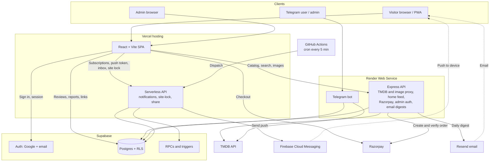
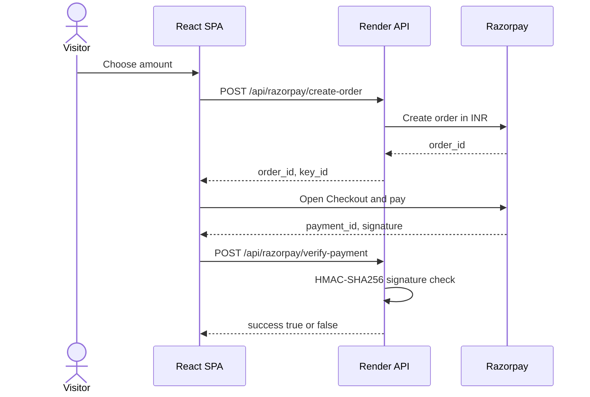
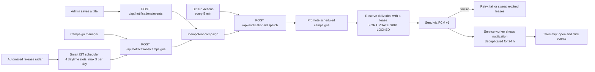

<div align="center">

# 🎬 MovieVerify

**A Netflix-inspired movie & TV discovery platform with user accounts, push and email notifications, a secure admin console, Telegram bot control and PWA support.**

[](https://movieverify.vercel.app)


</div>

---

## Table of Contents

- [About](#about)
- [Features](#features)
- [Tech Stack](#tech-stack)
- [Architecture](#architecture)
- [Screenshots](#screenshots)
- [Getting Started](#getting-started)
- [Environment Variables](#environment-variables)
- [Database](#database)
- [API Reference](#api-reference)
- [Telegram Bot](#telegram-bot)
- [Notification System](#notification-system)
- [Testing](#testing)
- [Project Structure](#project-structure)
- [Deployment](#deployment)
- [Security Notes](#security-notes)
- [Roadmap](#roadmap)
- [Disclaimer](#disclaimer)
- [Acknowledgements](#acknowledgements)
- [Author](#author)

---

## About

MovieVerify is a full-stack movie and TV discovery platform. Metadata (posters, ratings, cast, trailers) comes from **TMDB**. **Supabase** provides authentication, the Postgres database and row-level security. **Vercel serverless functions** run the notification pipeline, the site lock and shareable link previews, while a **Node.js service on Render** runs the Telegram bot, the payment API, the TMDB and image proxy, and email digests.

What began as a UI exercise has grown into a complete product: Google sign-in, per-user subscriptions, scheduled push and email campaigns, an admin console, bot-based administration, SEO tooling and an installable PWA, backed by an automated test suite.

---

## Features

### For visitors

- **Netflix-style interface**: rotating hero carousel, curated rows, a "today's releases" view and category tabs
- **Extra categories**: Anime, K-Drama, South series, Punjabi, Animated, Turkish/Pakistani and Documentary
- **Smart search**: debounced TMDB typeahead plus filters for genre, language, rating and sort order
- **Genre pages** with load-more pagination
- **Actor and actress directories** with a full filmography per person
- **Title details modal**: cast, runtime, recommendations, links per quality, TV seasons and episodes
- **Trailer player** with multiple fallback sources
- **Upcoming releases** with countdowns and a notify button
- **Personalisation**: *My List*, *Continue Browsing* and download history, stored locally in the browser
- **Accounts**: Google OAuth and email/password sign-in
- **Subscriptions ("Notify me")**: follow movies, TV series, individual seasons, actors and genres
- **Notification centre**: in-app inbox with unread badge, date filtering, mark-as-read and deep links
- **Browser push (FCM)**: per-category toggles, timezone-aware quiet hours, a daily push cap and sound alerts
- **Email digests** of today's releases, on by default and switchable per user
- **Reviews and ratings** (1–5 stars) with content moderation
- **Report a problem** on any title
- **Sharing** with dynamic Open Graph previews for movies and TV shows
- **Deep links**: `/?type=movie&id=…` opens a title directly
- **First-visit guide** and a cinematic intro animation
- **Support section**: ₹5 / ₹10 / ₹50 / custom donations through Razorpay
- **Site lock gate** controlled by the admin
- **Installable PWA** with a custom install prompt

### For the admin

- **Secure admin console** at `/admin`, protected by Supabase Auth plus an `admin_users` allow-list, with a brute-force lockout
- **Catalog manager**: TMDB lookup, per-quality links, custom descriptions, and season/episode editing for TV
- **Automatic release alerts**: saving a title or season publishes a notification without blocking the save
- **Campaign manager**: compose, preview, schedule and cancel push campaigns, track delivery and engagement, toggle categories and run the automated release radar
- **Smart release scheduler**: spreads announcements over four daytime slots (IST) with a daily cap
- **Email broadcast manager**: send or review "today's releases" digests
- **Reports inbox** and **analytics dashboard**: catalog completeness, review stats, pending reports
- **Site lock control**: toggle the gate and set the passcode
- **Telegram bot** administration (see [Telegram Bot](#telegram-bot))

### Engineering highlights

- **Concurrency-safe delivery**: leased reservations with `FOR UPDATE SKIP LOCKED`, retries and expired-lease sweeps prevent duplicate pushes
- **Row Level Security** with `FORCE ROW LEVEL SECURITY`, column-scoped grants, `security_invoker` views and an append-only audit log across the notification schema
- **Server-side site lock**: PBKDF2-hashed passcode, verified by a serverless function with rate limiting
- **Salted HMAC admin tokens** for backend admin endpoints and a strict CORS allow-list
- **Server-verified payments** using HMAC-SHA256 signature checks
- **Multi-device push self-healing**: token de-duplication, rotation and automatic clean-up of stale service workers
- **Performance work**: viewport windowing for off-screen rows (under 40 initial requests), lazy-loaded routes, an image proxy, TMDB response caching and a home-feed endpoint
- **Reference-counted scroll lock** that stays stable across nested modals
- **Error boundary** around the app to contain render crashes
- **SEO**: sitemap generated at build time and served dynamically, plus `robots.txt`
- **Social previews**: bot-aware Open Graph pages and poster prewarming for WhatsApp
- **Automated tests**: 288 tests on the native Node.js test runner

---

## Tech Stack

| Layer | Technology |
| --- | --- |
| Frontend | React 19, Vite 8, React Router 7 |
| Styling and motion | Tailwind CSS 3, Framer Motion, Lucide icons |
| Data and auth | Supabase (PostgreSQL, Auth, RLS), TMDB API |
| Notifications | Firebase Cloud Messaging (FCM v1), Web Push, service workers, Resend (email) |
| Serverless API | Vercel Functions (Node.js) |
| Backend service | Node.js, Express 5, `node-telegram-bot-api`, Razorpay SDK, `node-cache` |
| Scheduling | GitHub Actions (cron), Vercel cron |
| Testing | Node.js test runner (`node:test`), oxlint |
| Hosting | Vercel (frontend and serverless), Render (backend service) |

---

## Architecture

### System Architecture



### Payment Flow



---

## Screenshots

> Add your screenshots to `docs/screenshots/` and update the paths below.

| Home | Title Details |
| --- | --- |
|  |  |

| Notifications | Admin Console |
| --- | --- |
|  |  |

---

## Getting Started

### Prerequisites

- Node.js 20+
- A [TMDB](https://www.themoviedb.org/settings/api) account (v4 read access token)
- A [Supabase](https://supabase.com) project (Google provider enabled for sign-in)
- A [Firebase](https://firebase.google.com) project with Cloud Messaging (only for push notifications)
- A [Resend](https://resend.com) account (only for email digests)

### Installation

```bash
# 1. Clone
git clone https://github.com/akramiyi/movieverify.git
cd movieverify

# 2. Install dependencies
npm install

# 3. Configure environment
cp .env.example .env     # then fill in the values (see below)

# 4. Start the dev server
npm run dev
```

### Scripts

| Command | Description |
| --- | --- |
| `npm run dev` | Start the Vite dev server |
| `npm run build` | Production build, then generate the sitemap |
| `npm run sitemap` | Generate `sitemap.xml` only |
| `npm run preview` | Preview the production build |
| `npm run lint` | Run oxlint |
| `npm test` | Run all API and client tests |
| `npm run test:api` / `npm run test:client` | Run one half of the suite |

### Backend service

The Telegram bot, payment API, proxy and email digests live in `telegram-bot/`:

```bash
cd telegram-bot
npm install
npm run dev        # or: npm start
```

> Run **only one** instance of the bot at a time, otherwise Telegram returns `409 Conflict`.

---

## Environment Variables

> Never commit `.env` files. Anything prefixed with `VITE_` is bundled into the browser, so never put secrets there.

### Frontend (`.env`)

| Variable | Description |
| --- | --- |
| `VITE_SUPABASE_URL` | Supabase project URL |
| `VITE_SUPABASE_ANON_KEY` | Supabase anon (public) key |
| `VITE_API_URL` | Base URL of the Render backend (TMDB proxy, Razorpay) |
| `VITE_TMDB_TOKEN` | TMDB read token, used only where a direct call is still made |
| `VITE_USE_IMAGE_PROXY` | Route TMDB images through the backend image proxy |
| `VITE_APP_URL` | Canonical site URL |
| `VITE_FIREBASE_API_KEY`, `VITE_FIREBASE_AUTH_DOMAIN`, `VITE_FIREBASE_PROJECT_ID`, `VITE_FIREBASE_STORAGE_BUCKET`, `VITE_FIREBASE_MESSAGING_SENDER_ID`, `VITE_FIREBASE_APP_ID`, `VITE_FIREBASE_MEASUREMENT_ID` | Firebase web app config |
| `VITE_FIREBASE_VAPID_KEY` | Web Push certificate key for FCM |

### Vercel serverless functions (`api/`)

| Variable | Description |
| --- | --- |
| `SUPABASE_URL` | Supabase project URL |
| `SUPABASE_SERVICE_ROLE_KEY` | Service role key (**server only**) |
| `SUPABASE_ANON_KEY` | Anon key used to validate user JWTs |
| `INTERNAL_WORKER_SECRET`, `CRON_SECRET` | Secrets that authenticate the dispatch endpoint |
| `NOTIFICATION_DISPATCH_ENABLED` | Kill switch, must be `true` to send |
| `CAMPAIGN_API_SECRET` | Secret for machine-to-machine campaign ingestion |
| `FIREBASE_SERVICE_ACCOUNT` *or* `FIREBASE_PROJECT_ID`, `FIREBASE_CLIENT_EMAIL`, `FIREBASE_PRIVATE_KEY` | Firebase Admin credentials for FCM v1 |
| `TMDB_READ_TOKEN` | TMDB token used by share previews and scheduled campaigns |
| `SITE_LOCK_SECRET` | Pepper for site lock hashing |

### Render backend (`telegram-bot/`)

| Variable | Description |
| --- | --- |
| `PORT` | Provided by the host (defaults to `3000`) |
| `FRONTEND_URL` | Allowed CORS origin(s) |
| `TELEGRAM_BOT_TOKEN` | Bot token from BotFather |
| `TELEGRAM_ADMIN_IDS` | Comma-separated Telegram user IDs allowed to administer |
| `SUPABASE_URL`, `SUPABASE_SERVICE_ROLE_KEY` | Supabase connection (**server only**) |
| `TMDB_TOKEN` | TMDB read access token |
| `RAZORPAY_KEY_ID`, `RAZORPAY_KEY_SECRET` | Razorpay credentials (**secret is server only**) |
| `ADMIN_MASTER_PASSWORD`, `ADMIN_HMAC_SALT` | Admin token authentication |
| `SITE_LOCK_KEY` | Fallback site lock secret |
| `RESEND_API_KEY`, `RESEND_FROM_EMAIL` | Email digest delivery |
| `ADMIN_EMAIL` | Admin address(es) for digest copies |
| `CRON_SECRET` | Secret for external cron triggers |

### GitHub Actions

| Name | Type | Description |
| --- | --- | --- |
| `SUPABASE_URL`, `SUPABASE_ANON_KEY` | Repository secrets | Used by the keep-alive ping |
| `INTERNAL_WORKER_SECRET` | Repository secret | Authenticates the dispatch call |
| `PRODUCTION_NOTIFICATION_DISPATCH_ENABLED` | Repository variable | Set to `false` to pause the production dispatcher |

---

## Database

### Application tables

| Table | Purpose |
| --- | --- |
| `download_links` | Admin-managed entries: per-quality URLs and TV `seasons` as JSON |
| `movie_reviews` | User reviews and ratings |
| `movie_reports` | "Report a problem" submissions |
| `site_settings` | Single-row site lock configuration |
| `admin_users` | Allow-list of admin user IDs |

> These five tables are currently created in the Supabase dashboard rather than in `supabase/migrations/`. Tables created through the SQL editor also need explicit grants, otherwise requests fail with `403`:
>
> ```sql
> GRANT SELECT, INSERT ON movie_reviews TO anon, authenticated;
> GRANT DELETE ON movie_reviews TO authenticated;
> ```

### Notification schema (`supabase/migrations/`)

| Group | Tables |
| --- | --- |
| Devices and preferences | `notification_endpoints`, `notification_tokens` (view), `user_notification_preferences`, `notification_opt_outs` |
| Subscriptions | `movie_notify_requests`, `actor_notify_requests`, `genre_notify_requests` |
| Campaigns and delivery | `notification_campaigns`, `notification_deliveries` |
| Inbox and onboarding | `user_notifications`, `user_welcome_dispatches` |

Twelve ordered migrations define the tables, RPCs, triggers, RLS policies and compatibility layer. All notification tables have RLS **enabled and forced**: anonymous access is revoked, authenticated users can only reach their own rows, and campaign and delivery data is admin- or service-role-only. Dispatch, scheduling, welcome and telemetry logic runs through RPCs that only the service role may execute.

```bash
supabase db push
```

---

## API Reference

### Vercel serverless (`/api`)

| Endpoint | Auth | Purpose |
| --- | --- | --- |
| `GET /api/share` | None | Open Graph HTML for shared titles, then redirects to the app |
| `POST /api/site-lock/verify` | None (rate-limited) | Verify the site passcode with server-side PBKDF2 hashing |
| `GET, POST /api/notifications/preferences` | User JWT | Read and update notification preferences |
| `POST /api/notifications/register` | User JWT or anonymous | Register or refresh an FCM token |
| `POST /api/notifications/revoke` | User JWT or anonymous | Revoke a device token |
| `GET, POST, DELETE /api/notifications/subscriptions` | User JWT | Manage release subscriptions |
| `GET, PATCH /api/notifications/user` | User JWT | Fetch the inbox and mark as read |
| `POST /api/notifications/welcome` | User | Issue the first-login welcome notification |
| `POST /api/notifications/telemetry` | User | Record delivery and engagement events |
| `POST /api/notifications/campaigns` | Admin JWT or service key | Create or cancel campaigns |
| `POST /api/notifications/events` | Admin JWT or service key | Publish a release or update event |
| `POST /api/notifications/dispatch` | Worker secret + kill switch | Promote scheduled campaigns and send due deliveries |

### Render backend

| Endpoint | Purpose |
| --- | --- |
| `GET /health` | Health check, returns `{ "status": "ok" }` |
| `GET /api/home-feed` | Cached home feed of top titles |
| `GET /api/tmdb/*` | TMDB proxy with the token kept server-side |
| `GET /api/image/:size/*` | Cached image proxy for posters and backdrops |
| `POST /api/razorpay/create-order` | Create a Razorpay order (INR) |
| `POST /api/razorpay/verify-payment` | Verify the payment signature server-side |
| `POST /api/admin-login` | Exchange the admin credential for a salted HMAC token |
| `GET /api/admin-verify` | Validate an admin token |
| `GET, POST /api/admin/daily-digest` | Send the daily releases or trending digest by email |
| `GET /api/admin/email-broadcast/stats` | Registered-user count and past email campaigns |

---

## Telegram Bot

| Command | Access | Description |
| --- | --- | --- |
| `/start`, `/help` | Everyone | Welcome message and command guide |
| `/search <query>` | Everyone | Search TMDB and get quality buttons or season/episode keyboards for titles that have links |
| `/admin` | Admin | Open the admin menu |
| `/stats` | Admin | Live metrics for the catalog and notification system |
| `/list` | Admin | Recently updated titles and link configurations |
| `/searchadmin <query>` | Admin | Search and edit links through a guided 480p → 720p → 1080p flow |
| `/broadcast <msg>` (alias `/notify`) | Admin | Send a custom push alert to subscribers |

Admin access is enforced by checking the sender's numeric Telegram ID against `TELEGRAM_ADMIN_IDS`.

---

## Notification System



Quiet hours, per-category opt-outs and daily caps are enforced before a push is leased. An in-app inbox copy is always kept, even when push is suppressed. Email digests follow the user's email-channel preference.

---

## Testing

The project uses the native Node.js test runner.

```bash
npm test
```

- `tests/api/`: API contracts, campaign scheduling, the dispatch worker, authorization and rate limiting
- `tests/client/`: component rendering, hooks and the notification sound fallback
- `tests/db/`: database fixtures and preflight scripts

Current status: **288 / 288 passing**.

---

## Project Structure

```
movieverify/
├── .github/workflows/        # Dispatch cron, diagnostics, Supabase keep-alive
├── api/                      # Vercel serverless functions
│   ├── notifications/        # campaigns, events, dispatch, register, ...
│   ├── site-lock/            # Passcode verification
│   ├── share.js              # Open Graph share pages
│   └── _lib/                 # Supabase server client, FCM worker, services
├── docs/                     # Runbooks and implementation notes
├── functions/                # Cloudflare Pages Functions (sitemap, edge proxy)
├── public/                   # manifest, service workers, robots.txt, sitemap
├── scripts/                  # Sitemap generator
├── src/
│   ├── components/           # UI, admin console, notification centre, ...
│   ├── hooks/                # useTMDB, useSubscriptions, usePushNotifications, ...
│   ├── pages/                # Genre and actor listing pages
│   ├── services/             # Firebase client
│   ├── utils/                # Release scheduler, moderation, notification helpers
│   ├── data/                 # Supabase client
│   ├── App.jsx
│   └── main.jsx
├── supabase/migrations/      # Notification schema, RLS, RPCs, triggers
├── telegram-bot/             # Express API, Telegram bot, Razorpay, proxy, email
│   └── handlers/             # userHandlers.js, adminHandlers.js
├── tests/                    # api, client and db tests
└── vercel.json               # Rewrites, cron and function settings
```

### Routes

| Route | Access | Description |
| --- | --- | --- |
| `/` | Public (site lock aware) | Home feed, today's releases, search, support section |
| `/genre/:genreSlug` | Public | Genre listing with load-more |
| `/actors`, `/actresses` | Public | Full actor and actress directories |
| `/admin` | Admin only | Admin console |
| `/share/:type/:id` | Public | Rewritten to `/api/share` for crawlers, redirects people to `/?type=…&id=…` |

---

## Deployment

| Part | Platform | Notes |
| --- | --- | --- |
| Frontend and `/api` | **Vercel** | Set all `VITE_*` and server variables, then redeploy (`VITE_*` values are inlined at build time). A daily cron also calls the dispatch endpoint as a backstop |
| Backend service | **Render** (Web Service) | Root directory `telegram-bot`, build `npm install`, start `node index.js`, health check `/health` |
| Scheduling | **GitHub Actions** | Dispatch every 5 minutes, a manual staging dispatch, a schedule diagnostic and a twice-daily Supabase keep-alive |

---

## Security Notes

- **Admin access** needs a valid Supabase session **and** a row in `admin_users`. Backend admin endpoints use salted HMAC tokens.
- **Site lock** passcodes are hashed with PBKDF2 and verified on the server with rate-limited lockout.
- **CORS** on the backend uses an explicit origin allow-list.
- **Notification tables** use forced RLS, column-scoped grants and an append-only audit log.
- **Payments** are trusted only after server-side signature verification. A Razorpay webhook and payment ledger are not implemented yet.
- Keep the Supabase **service role key**, Razorpay **secret**, Firebase **private key**, Resend key and worker secrets on the server only.

---

## Roadmap

- [ ] Move the DDL and RLS policies of the five core tables into `supabase/migrations/`
- [ ] Razorpay webhook and payment ledger
- [ ] Route the remaining direct TMDB usage (genre pages) through the proxy
- [ ] Remove unused components and legacy files
- [ ] Complete `.env.example` with every required variable
- [ ] Add a `LICENSE` file

---

## Disclaimer

MovieVerify does **not** host or store any media files. Titles, images and metadata are provided by TMDB, and trailers are embedded from third-party video platforms. Any external download links are entered manually by the site administrator, who is solely responsible for ensuring they have the right to distribute that content. This repository is intended for educational and portfolio purposes.

---

## Acknowledgements

- [TMDB](https://www.themoviedb.org/): *This product uses the TMDB API but is not endorsed or certified by TMDB.*
- [Supabase](https://supabase.com), [Firebase](https://firebase.google.com), [Vercel](https://vercel.com), [Render](https://render.com), [Razorpay](https://razorpay.com), [Resend](https://resend.com)
- [Framer Motion](https://www.framer.com/motion/), [Lucide](https://lucide.dev), [Tailwind CSS](https://tailwindcss.com)

---

## Author

**Akram**
B.Tech Computer Science, Brainware University

[](https://github.com/akramiyi)

If you like this project, consider giving it a ⭐
